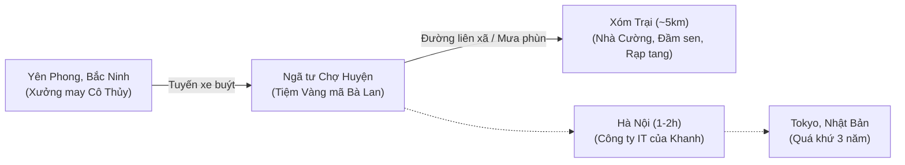

# HORRIBLE CANON BIBLE
> **Repository Source of Truth & Definitive Canon Reference**  
> **Project:** `anhdaijka/horrible@main` | **Target Audience:** Internal Reviewer / Editor in ChatGPT Project  
> **Status:** Strictly Consolidated from Repository Truth. No unauthorized lore creation. Spoilers fully unlocked.  
> **Latest Reconciliation:** 2026-09-11 (Decisions D-048 to D-051 fully codified).

---

## 1. Project Identity

- **Title:** *Horrible* (Volume 1 Working Title: *Những chuyện tưởng đã kết thúc*).
- **Genre:** Ghost / spiritual horror novel (*truyện kinh dị tâm linh*) with a fair-play mystery structure.
- **Setting & Era:** Contemporary Northern Vietnam (circa 2026). Primary cultural and physical texture: Kinh Bắc (former Bắc Ninh – Bắc Giang semi-urbanizing rural basin, roughly 1–2 hours from Hanoi).
- **Narrative POV:** Close third-person limited (Limited 3rd POV) centered on protagonist Nguyễn Minh Khanh. Single active consciousness per scene. Storyteller authority is permitted for retrospective framing and ominous pacing, but strictly forbidden from leaking future deductive logic or debunking mysteries prematurely.
- **Core Horror Premise:** An IT engineer returns from Japan to his family's long-established votive-paper shop (*tiệm vàng mã*) beside a busy market crossroads. Ordinary family life and commerce become entangled with the dead through karmic tripwires, uncollected death orders (*đồ đoạt mệnh*), and ancient community crimes.
- **Detective Premise:** A fair-play deductive mystery where uncanny anomalies serve dual-layer functions: visceral, bone-chilling supernatural dread on first read, and rigorous, grounded investigative clues on reread. The mystery provides architectural structure but never demystifies or explains away genuine supernatural reality.
- **Tone:** Grounded realism, claustrophobic psychological dread, macabre folk banter (*bông đùa nửa thật / folk gallows humor*), and poignant human tragedy.

---

## 2. Canon Authority & Source Hierarchy

### 2.1 Source Hierarchy (Order of Precedence)
1. **Direct Author Instructions & Session Consensus:** `author/decisions.md` (D-001 to D-051), `author/session-state.md` (active operating contract).
2. **Locked Constitutional Documents:** `author/creative-constitution.md`, `author/boundaries.md`, `author/style-bible.md`.
3. **Confirmed Continuity Registries:** `continuity/state.md`, `chapters/_index.md`, `scenes/_index.md`, `characters/*.md`, `worldbuilding/*.md`.
4. **Verified Cultural Research:** `research/verified/*.md`.
5. **Approved Narrative Arc Outlines:** `plot/arcs/*.md` (specifically D-050 / D-051 Master Model).
6. **Active Approved Manuscript Drafts:** `chapters/chapter-01.md` (`Đơn hàng đoạt mệnh`, active draft ~3900 words, set on morning of 14 Giêng). Chapters 2–7 planned under D-050/D-051.
7. **Postmortems & Audits:** `revisions/reviews/*.md`.
8. **Deprecated / Rejected Material:** Discarded prototypes (`Tiếng chợ`, `Người đặt`), abandoned normal-first notes.

### 2.2 Epistemic Status Tags
- `CONFIRMED CANON`: Fully approved by author, registered in continuity registries, and actively codified in repo truth.
- `PLANNED / OUTLINE`: Structurally approved in arc blueprints (e.g., D-050 / D-051 Master Model) awaiting on-page drafting.
- `CHARACTER BELIEF`: Subjective cultural or personal interpretation by a character (may be true, false, or distorted).
- `READER-FACING CLAIM`: What characters or narration state on-page at a specific point in time.
- `INFERENCE`: Deductions made by characters or readers; not yet narrator-certified fact.
- `UNVERIFIED`: Cultural or technical claims not yet backed by verified research.
- `DEPRECATED`: Explicitly rejected concepts or prototypes.

### 2.3 Conflict Resolution Rules
- If two repository files contradict, the higher-priority source wins.
- Draft prose cannot overwrite established canon unless accompanied by an approved review audit.
- Any uncodified forks must be validated against the author's explicit decisions.

---

## 3. World & Supernatural Canon

### 3.1 `OBJECTIVE SUPERNATURAL TRUTH`
- **Ontological Reality of Spirits:** Ghosts, spirits (*oan hồn*), and supernatural interventions are objectively real. Ambiguity is an optional stylistic ending, never a mandatory worldview. Realism is the floor, not the ceiling.
- **The Hollow Vessel Phenomenon (*Hiện tượng Hút vong*):** In traditional votive-paper craft, bamboo struts are the bones (*nan tre là xương*), paper pasted with rice glue is the flesh (*giấy bồi dán hồ là da thịt*), and mineral pigments are the blood. An intricate custom votive object (e.g., the Czech paper cassette radio) completed but not burned immediately for its intended recipient becomes an empty shell (*xác rỗng không hồn*). Over night, especially across the Full Moon (*đêm Rằm*), wandering spirits or vengeful ghosts attach to it and inhabit it.
- **Physical Force and Direct Lethality:** Vengeful spirits possess genuine physical agency. In Case Zero, Thoa's ghost does not merely cause an optical illusion or a clumsy stumble; she physically manifests on the staircase, snatches Cường, and snaps his cervical vertebrae backwards 180 degrees in mid-air before he hits the stairs.
- **Technological & Sensory Manifestations:** Spirits manipulate physical and electronic media:
  - Condensing freezing moisture on glass countertops around votive items (*sương lạnh buốt giá*).
  - Emitting localized mechanical sounds from hollow paper objects: dry magnetic tape hiss (*tiếng rè rè xèo xèo của sợi băng từ cọ xát vào đầu từ*) and unassisted mechanical latches popping (*TÁCH!*).
  - Transmitting audio across communication channels (tape hiss and physical sounds captured in Cường's unsent Zalo voice message).
  - Leaving physical traces from their death site: wet, foul-smelling lotus pond mud (*bùn đầm sen tanh nồng*) and distinct fingerprints/handprints on window sills.
- **Occult Binding and Talisman Decay:** Spirits can be bound to geographical sites using heterodox rituals (e.g., a green bamboo stake carved with cinnabar talismans: *cọc tre khắc bùa trấn thủy*). In anaerobic mud, bamboo decomposes across approximately 30 years. Once decomposed or physically disturbed by excavation, the bound spirit awakens with unmitigated wrath.
- **Appearance & Mimicry Rules:** A ghost can project the facial likeness of a living relative (mimicking cô Thủy's facial structure on CCTV) while retaining its own indelible physical traits (innate left-handedness, slender fingers) and leaving physical clues behind.
- **Limits of the Supernatural:** Spirits are bound by their emotional trauma, death location, and personal relics. They are not omniscient, omnipotent, or interchangeable fantasy monsters.

### 3.2 `CHARACTER / FOLK BELIEFS` (Subjective / Folk Interpretation)
- **Đồ đoạt mệnh (Taboo of Votive Commerce):** Votive shopkeepers believe that accepting an uncollected custom order for someone who dies suddenly before Rằm brings a severe curse upon the shop (*ám tiệm, rước họa vào nhà*).
- **Trùng tang & Thần Trùng:** Village elders believe that dying at an ominous hour (*giờ kỵ*) or dying violently causes a demonic entity (*Thần Trùng*) to torment the corpse and drag subsequent family members to the grave within days or months. Ritual specialists use red talismans over the face and four iron nails in coffin corners to "seal" the soul.
- **Underworld Tally Expiration (*Chấm sổ cõi âm*):** Folk belief cited by bà Lan (from grandfather) that a person's life span in the underworld records may terminate days before physical death, prompting spirits or underworld emissaries to order burial goods in advance to prepare for collection.
- *Epistemic Boundary:* These beliefs drive character panic, social rituals, and misdirections; they do not dictate the objective rules of the afterlife.

---

## 4. Geography & Locations

### 4.1 Tiệm Vàng mã Gia đình & Ngã tư Chợ Huyện
- **Type:** Commercial shop & family residence.
- **Location:** At a busy market crossroads in a semi-urbanizing district of contemporary Bắc Ninh / Kinh Bắc.
- **Layout:** 
  - Ground floor: Front glass counter (*quầy thu ngân bằng kính*), stacked piles of votive paper, bamboo frames (*nan tre*), hanging paper garments, copper incense burner at the Thần Tài altar in the corner. Entrance protected by a rolling metal door (*cửa cuốn*) and padlock. Overhead beam (*xà ngang*) holds a dust-covered Dahua dome security CCTV camera pointing directly down at the counter.
  - Mezzanine (*gác lửng*): Houses the Dahua 2TB DVR unit, old 17-inch LCD monitor, wired optical mouse, and Khanh's temporary workspace with his ThinkPad.
  - Rear: Ancestor altar (*bàn thờ gia tiên*), domestic living quarters, kitchen.
- **Personnel:** Bà Lan (runs the shop), Khanh (temporarily staying/remote working), Ông Hùng (carpentry/construction support).
- **Key Scenes:** Chapters 1, 2, 4. The place where the advance order is placed, the CCTV is inspected, the paper radio hisses and pops open, and panic brews.

### 4.2 Xóm Trại & Nhà Ông Vũ Văn Cường
- **Type:** Rural hamlet, scene of the historical murder and present-day death.
- **Location:** Approximately 5 km from the market crossroads, accessible via a winding, unpaved brick lane vulnerable to winter sương muối, ditch culverts, and dog packs.
- **Layout of Cường's House:** 
  - Front yard: Covered by a striped blue-and-white funeral tent (*rạp tang bạt sọc*) during Chapters 3 and 5. Three masonry steps (*bậc tam cấp*) coated in thick white lime powder (*vôi bột*) to mask dried blood.
  - Ground floor main room: Houses the wooden coffin (*áo quan gỗ dổi*) supported by wooden stools. Contains the fatal steep wooden staircase (*cầu thang gỗ*) leading to the second floor. The 13th step is where Cường was seized.
  - Rear bedroom (*buồng ngủ phía sau*): Occupied by cô Thủy during the wake. Features a barred wooden window directly overlooking the adjacent lotus pond.
  - Lotus pond (*Đầm sen*): Sits right behind Cường's property. Historic site where Thoa was drowned in 1996. In 2026, it is undergoing draining and backfilling by construction excavators for the district road-widening project.
- **Personnel:** Ông Cường (deceased victim), Cô Thủy (staying during funeral), Lan Anh (daughter), Đinh Công Toàn (son-in-law), Thầy cúng Bình (conducting rites), Trưởng họ Cổn.
- **Key Scenes:** Chapters 3, 5, 6, 7 (funeral, bedroom breach, Zalo message discovery, midnight pond excavation).

### 4.3 Khu công nghiệp Yên Phong, Bắc Ninh
- **Type:** Industrial garment manufacturing hub.
- **Location:** Industrial zone in Bắc Ninh, accessible by inter-district bus from the district town.
- **Relevance:** Workplace of Vũ Thị Thủy. Houses the biometric fingerprint time-clock terminal confirming her airtight physical alibi on the morning of mùng 10.

---

## 5. Character Bible

### 5.1 Nguyễn Minh Khanh (Central POV Protagonist)
- **Age / Year of Birth:** 27 years old (born ~1999).
- **Gender:** Male. Quê quán: Huyện lỵ, Bắc Ninh.
- **Occupation:** Senior software engineer at a Vietnam–Japan tech firm; recently returned after 3 years onsite in Tokyo; currently on leave/remote work before resuming at Hanoi branch.
- **Physical Canon:** Medium-tall, lean desk-worker build, untidy short black hair when at home. Long, unadorned fingers. Loose, slouched posture when relaxed; goes completely still and focused when analyzing anomalies. Wears sneakers, simple fleece jackets, casual clothes.
- **Social Address & Kinship:** Addressed as `Khanh` or `anh`. Calls parents `bố`, `mẹ`; sister `chị Hạnh`; classmate `mày – tao` (with Thắng); childhood friend `Mai`.
- **Personality & Flaw:** Analytical, grounded, skeptical believer. Demands causal closure (*khát khao giải thích nhân quả*). Once an anomaly registers, he obsessively digs. Can be lazy, domestic, and irritable when tired. Retains childhood fear of ghosts.
- **Abilities & Boundaries:**
  - *Tech Skills:* CCTV extraction, DVR logs, timestamp analysis, Zalo offline message queue mechanics, audio waveform inspection.
  - *Supernatural Knowledge:* Zero magical powers; no inherited exorcism skills; no "chosen one" status.
  - *Folk Knowledge:* Knows basic village customs through immersion, but clumsy and awkward with formal funeral protocol (`vái hai vái`).
  - *What he knows at start:* An order was placed mùng 10 for a man who died night of the 13th.
  - *What he DOES NOT know at start:* 1996 drowning, family murder conspiracy, Thoa's identity, the Czech radio's history, the rotting talisman.
- **Non-Retcon Facts:** Khanh is strictly an IT engineer; he never becomes an occult practitioner or police detective.

### 5.2 Trần Thị Lan (Bà Lan — Mother)
- **Age:** 55 years old.
- **Role:** Operator of the family votive shop; primary source of oral folk testimony.
- **Physical Canon:** Slightly small, sturdy, dark hair silvering at temples tied in a black plastic clip. Hands dry, calloused, ink- and glue-stained; quick, economical movements around paper and cash drawers.
- **Social Address:** Narrated as `mẹ anh`, `bà Lan`. Never bare `Lan`.
- **Personality & Voice:** Practical, sharp-tongued, socially observant. Strong memory for customers and neighborhood gossip. Distinguishes what she saw from what people say (*"thì người ta kể thế"*). Pragmatic believer; terrifies easily when professional votive taboos (*đồ đoạt mệnh*) are triggered.

### 5.3 Vũ Thị Thủy (Conspirator & Target)
- **Age:** 51 years old.
- **Role:** Surviving younger sister of Cường and Thoa; garment worker in Yên Phong; living conspirator in inheritance intimidation.
- **Physical Canon:** Sallow, worn skin from factory work. Broken nose bridge, high cheekbones, slanted eyes, dark mole left of nostril. **Crucial Physical Anchor:** Strictly right-handed. Left wrist has a prominent deformed bony protrusion (from childhood fracture at age 12); four left fingers are permanently contracted like a claw and cannot grip or write.
- **Social Address:** Narrated as `cô Thủy`.
- **Secret & Crime:** Accomplice in Thoa's 1996 murder. In 2026, launched a ghost intimidation campaign against Cường (playing cassette audio, slashing photo) to force a land settlement. Trapped when Thoa's real ghost awakens and turns the retribution onto her.
- **Alibi:** Biometric fingerprint clock-in at Yên Phong factory from 07:00 to 17:00 on mùng 10.

### 5.4 Vũ Thị Thoa (The Vengeful Spirit / Catalyst)
- **Age at Death:** 20 years old (born 1976, died summer 1996).
- **Physical Canon (in life & CCTV):** Slender, pale, delicate bone structure, high cheekbones, almond eyes. **Innate Left-Handedness:** Long, slender, extraordinarily agile left fingers when sketching or writing.
- **Supernatural Status:** Oan hồn bound in the pond mud for 30 years by a bamboo talisman. Awakens upon talisman decay. Projects Thủy's facial likeness on CCTV but uses her own left hand. Snaps Cường's neck on the staircase. Emits tape hiss from paper objects. Demands return of her Czech cassette radio.

### 5.5 Vũ Văn Cường (Case Zero Victim)
- **Age:** 59 years old (died night of 13th Giêng 2026).
- **Physical & Social Baseline:** Robust, loud, rides red Honda Wave, plays alley chess, watches evening news.
- **Secret:** Kept Thoa's Czech cassette radio (which recorded her dying cries) as blackmail against family, burying it with a 30-year talisman. Refused to share road frontage inheritance with Thủy.
- **Death:** Neck snapped backwards 180 degrees in mid-air on the staircase by Thoa's ghost at ~22:54 on 13th Giêng.

### 5.6 Supporting & Recurring Cast
- **Lan Anh (26–27):** Daughter of Cường. Discovers death, rushes to tiệm mã for burial clothes in Ch 1. Later finds husband Toàn's sedatives and burns them in votive fire (The Loyalty Trap). Signs autopsy waiver with Trưởng họ Cổn.
- **Đinh Công Toàn (31):** Son-in-law of Cường (husband of Lan Anh). Debt-ridden dump-truck driver. Slipped heavy Diazepam into Cường's medicinal wine on the night of the 13th to steal land deed. Panics when Cường dies; uses "burglary" theory to deflect. *(Note: Named Đinh Công Toàn to avoid collision with Khanh's brother-in-law Lê Đức Tuấn).*
- **Trưởng họ Vũ Cổn (The Patriarch):** Elder head of the Vũ clan. The "Fourth Accomplice" who sanctioned Thoa's murder in 1996 (*"Gia môn bất hạnh, dìm nó cho khuất mắt"*). Pressures family and police to bury Cường quickly without autopsy to preserve family dignity and hide 1996 crime (DECISION 05 A).
- **Thầy cúng Đặng Văn Bình (58):** Local ritual specialist. Apprentice of the 1996 heterodox ritualist who buried Thoa's radio. Met secretly with Cường night before; rushes Cường's burial with red talismans and iron coffin nails to suppress spiritual contamination.
- **Đặng Việt Long:** Local police officer. Investigates Cường's death; initially accepts burglary/fall theory; accepts signed autopsy waiver from Trưởng họ Cổn and Lan Anh while harboring quiet suspicions (DECISION 05 A).
- **Đào Văn Sang (Cò đất):** Real estate speculator stoking conflict between Toàn and Thủy to force a cheap land buyout.
- **Hoàng Ngọc Mai (27):** Khanh's childhood friend. Runs a major local food/vegetable wholesale logistics business. Pragmatic half-believer. Strictly platonic with Khanh (zero romance). Provides underworld and market movement intel.
- **Lê Văn Thắng (27):** Khanh's high school classmate. Technician at an aluminum-glass workshop. Cheerful, married with a child, awkward at funerals. Grounds Khanh socially in the village (Ch 3).
- **Nguyễn Văn Hùng (57):** Khanh's father. Practical construction/carpentry worker. Quiet, observant, supports the shop.
- **Nguyễn Minh Hạnh (35) & Lê Đức Tuấn:** Khanh's older sister (primary school teacher) and brother-in-law.

---

## 6. Master Timeline

### 6.1 Objective Chronology (Real-World Sequence)

| Date / Time | Event | Location | Characters Involved | Canon Status |
|---|---|---|---|---|
| **1976** | Vũ Thị Thoa is born (naturally left-handed, artistic). | Xóm Trại | Thoa, Family | `CONFIRMED CANON` |
| **Summer 1996** | Vũ Thị Thoa (20) drowned in lotus pond during violent confrontation over money/forced marriage. Sanctioned by Trưởng họ Vũ Cổn. Thoa's Czech cassette radio on `REC` captures murder. | Xóm Trại lotus pond | Thoa, Cường, Thủy, Trưởng họ Cổn | `CONFIRMED CANON` |
| **Late Summer 1996** | Cường steals cassette radio as blackmail. Family hires heterodox specialist after Thầy Kính (Khanh's grandfather) refuses (`Không nhận lễ`). Specialist buries radio with 30-year bamboo talisman (*cọc tre khắc bùa trấn thủy*). Thoa's name erased from genealogy. | Pond bank, Xóm Trại | Cường, Patriarch, Heterodox master, Apprentice Bình | `CONFIRMED CANON` |
| **2023–Jan 2026** | Khanh works onsite in Tokyo, experiencing ambiguous night incidents. | Tokyo, Japan | Khanh | `CONFIRMED CANON` |
| **Late Jan 2026** | Khanh returns to Vietnam; stays at family home in Bắc Ninh on remote work leave. | Votive shop, Bắc Ninh | Khanh, Lan, Hùng | `CONFIRMED CANON` |
| **Early Feb 2026** | Road-widening excavators begin filling pond. 30-year talisman rots. Thủy begins nocturnal ghost-scare campaign for land share. Sang stokes conflict. Toàn falls into debt. | Xóm Trại | Thủy, Cường, Toàn, Sang | `CONFIRMED CANON` |
| **10 Giêng, 09:08:41** | Entity bearing Thủy's face enters shop; effortlessly uses left hand to sketch Czech cassette radio and order goods for living Cường. Stares at CCTV for 4s at 09:11:03. | Votive shop counter | Entity (Thoa mimicking Thủy), Lan | `CONFIRMED CANON` |
| **10 Giêng, 09:14** | Bà Lan sends Zalo message to outside craftsman ordering custom paper radio. | Votive shop | Lan | `CONFIRMED CANON` |
| **13 Giêng, Day** | Pickup deadline expires; purchaser does not arrive to collect custom radio. | Votive shop | Lan | `CONFIRMED CANON` |
| **13 Giêng, 22:30** | Toàn drugs Cường's wine with Diazepam. Thủy plays tape audio by the pond. | Cường's house | Toàn, Thủy, Cường | `CONFIRMED CANON` |
| **13 Giêng, 22:54** | Cường hears Thoa's music, panics, records 38s Zalo voice message to Thủy. Message sticks in offline queue. Thoa's ghost snaps Cường's neck 180° in mid-air on staircase. | Cường's staircase | Cường, Thoa's ghost | `CONFIRMED CANON` |
| **14 Giêng, Sáng** | Lan Anh discovers Cường's corpse. Police Long inspects scene (rules burglary/fall). Lan Anh rushes to votive shop. Advance order revealed. Lan Anh flees. Taboo *đồ đoạt mệnh* triggered. Khanh spots frost & 13 steps sketch. | Xóm Trại & Votive shop | Lan Anh, Lan, Khanh, Long, Cổn | `CONFIRMED CANON` |
| **14 Giêng, Trưa** | Khanh extracts Dahua CCTV footage on mezzanine. Thủy's face identified, but left-hand dexterity conflicts. Lan calls Thủy at Yên Phong bus station; Thủy screams at Thoa's name. | Votive shop mezzanine | Khanh, Lan, Thủy (phone) | `CONFIRMED CANON` |
| **14 Giêng, Chiều** | Khanh attends wake at Xóm Trại to appease spirit. Meets Thắng. Observes neck splints, lime on blood. Thủy arrives: withered left wrist rules out CCTV entity. Trưởng họ Cổn & Lan Anh sign autopsy waiver; Long hands over body. | Xóm Trại wake | Khanh, Thắng, Thủy, Cổn, Lan Anh, Long | `CONFIRMED CANON` |
| **14 Giêng, Sẩm tối** | Khanh debriefs with Lan. Tea lady (84yo) reveals 1996 drowning of left-handed Thoa and missing Czech radio. Paper radio emits tape hiss, door pops open (*TÁCH!*). Thủy calls in terror: something scratching at bedroom window. | Votive shop | Khanh, Lan, Thủy (phone) | `CONFIRMED CANON` |
| **14 Giêng, 19:18** | Relatives plug Cường's phone into altar charger. Wi-Fi connects; 38s voice message delivers to Thủy. | Xóm Trại | Thủy | `CONFIRMED CANON` |
| **14 Giêng, 19:30** | Khanh and Lan rush to Xóm Trại. Find mud left-hand print on window. Khanh analyzes 38s Zalo queue and audio of the neck snap. Paper radio rustles. | Cường's rear bedroom | Khanh, Lan, Thủy, Toàn | `CONFIRMED CANON` |
| **Đêm 14 – Rằm (Ch 6–7+)** | Khanh detects human inconsistencies in Thủy and Toàn. Lan Anh burns sedative blister pack in votive fire (The Loyalty Trap). Police bust Thủy's alibi. Waveform analysis proves mid-air fracture. Midnight excavation unearths real radio & rotting talisman. Murder tape plays. Retribution strikes. Grandfather's ledger: `Không nhận lễ`. | Xóm Trại / Pond | Khanh, Thủy, Toàn, Thoa, Long, Bình, Cổn | `PLANNED / OUTLINE` |

---

## 7. Volume 1 & Case Zero Act Structure

### 7.1 Case Zero (16–20 Chapters, 4 Acts under D-050 / D-051)

#### Act I: The Anomaly & The Midnight Terror (Chapters 1–5)
- **Chapter 1: `Đơn hàng đoạt mệnh` (Sáng 14 Giêng - Active Draft ~3900 words):** Lan Anh đến tiệm vàng mã mua đồ khâm liệm cho ông Cường (chết đột ngột đêm 13 do ngã cầu thang). Phát hiện đơn hàng chiếc đài cassette giấy bồi đặt từ sáng mùng 10 khi Cường còn sống khỏe mạnh. Lan Anh hoảng loạn bỏ chạy vì gia đình không ai tên Thoa. Dị tượng sương lạnh quanh chân đài và bản phác thảo 13 bậc thang có chữ "Đêm 13". Khanh nhìn lên camera Dahua. *(DECISION 01 B & 03 A applied).*
- **Chapter 2: `Bàn tay trái` (Trưa 14 Giêng - CCTV Lookback):** Khanh trích xuất CCTV Dahua sáng mùng 10. Người phụ nữ vóc dáng cô Thủy nhưng viết vẽ thuần thục bằng tay trái; ánh nhìn 4 giây nhìn trừng trừng vào camera. Nhận diện tên "Thoa" qua kết hợp video và sổ ghi/trí nhớ bà Lan (DECISION 04 A). Cuộc gọi đến bến xe Yên Phong xác nhận Thủy có alibi chấm công, tay trái bị tật khoèo không thể vẽ viết, và tiếng thét hoảng loạn khi nghe tên Thoa.
- **Chapter 3: `Rạp tang xóm Trại` (Chiều 14 Giêng):** Khanh sang viếng đám tang để giải tỏa taboo đồ đoạt mệnh. Gặp bạn học Lê Văn Thắng. Quan sát thương tích cổ gãy vặn ngược gần 180 độ. Đối mặt cô Thủy thật với cánh tay trái teo quắp (đập tan giả thuyết người sống). Thủ tục pháp lý: Trưởng họ Vũ Cổn và Lan Anh làm đơn cam kết từ chối mổ tử thi để kịp giờ hoàng đạo nhập quan; Công an Long bàn giao thi thể nhưng ngầm nghi vấn (DECISION 05 A).
- **Chapter 4: `Băng từ rỗng` (Sẩm tối 14 Giêng):** Bà Lan nghe bà cụ 84 tuổi ở quán nước chè kể vụ án năm 1996: Vũ Thị Thoa thuận tay trái, chết đuối bí ẩn ở đầm sen, bị gia tộc xóa tên, chiếc đài Tiệp biến mất. Chiếc đài giấy tại tiệm tự phát tiếng xèo xèo sợi băng từ rỗng và nắp bật mở (*TÁCH!*). Cô Thủy gọi điện thất thanh báo có thứ cào cửa sổ buồng ngủ.
- **Chapter 5: `Đêm áp Rằm` (19:30 tối 14 Giêng):** Khanh và mẹ vào buồng ngủ xóm Trại. Vệt bùn đầm sen hình bàn tay trái trên bậu cửa sổ. Giải mã tin nhắn Zalo 38 giây gửi lúc 22:54 đêm 13 kẹt hàng đợi offline vừa được Wi-Fi đẩy về máy Thủy: tiếng đài Tiệp, tiếng bước chân ướt lết, tiếng cào móng tay, và tiếng xương cổ Cường gãy *RẮC!*. Chiếc túi nilon bọc đài giấy phồng lên sột soạt.

#### Act II: The Breather & The Human Suspect Web (Chapters 6–10)
- **Chapter 6: `Rạn nứt đồng lõa`:** Khởi đầu Act II. Khanh làm việc từ xa tại quê nhà. Bà Lụa mua đồ giỗ kể chuyện cọc tre 1996. Sự rạn nứt của thế chân vạc nghi phạm: Đinh Công Toàn hoảng loạn vì bỏ thuốc an thần Diazepam vào rượu Cường; Lan Anh phát hiện vỉ thuốc và lén đốt trong đống lửa hóa vàng (The Loyalty Trap); Thầy Bình che giấu bùa chú cọc tre; Cò đất Sang kích động tranh chấp.
- **Chapters 7–10:** Phân tích kỹ thuật và cú sụp đổ của giả thuyết đời thường: Khanh phân tích waveform âm thanh phát hiện xương cổ gãy *ở trên không trung* trước khi chạm bậc thang; loa của Thủy đã hỏng từ lâu; Thoa thực sự hiện hữu.

#### Act III: The Excavation & Legal Collapse (Chapters 11–15)
- Công an Long phá vỡ alibi nhà máy của Thủy. Thủy thú nhận âm mưu giả ma dọa Cường nhưng kinh hoàng khẳng định ma thật đã giết Cường.
- Cuộc đua trước giờ máy xúc san lấp đầm sen: khai quật cọc tre yểm bùa 30 năm và chiếc đài cassette Tiệp Khắc thật bị chôn giấu dưới bùn.

#### Act IV: Cosmic Retribution & Grandfather's Ledger (Chapters 16–20)
- Băng cassette 1996 phát lại tiếng kêu cứu của Thoa. Oan hồn Thoa giáng đòn trừng phạt tâm linh lên những kẻ thủ ác còn sống (Thủy, Cổn).
- Tang lễ kép. Khanh tìm thấy trang sổ năm 1996 của ông nội Kính: `Không nhận lễ`.

---

## 8. CASE ZERO — FULL MYSTERY BIBLE

### 8.1 Case Premise
On the morning of mùng 10 tháng Giêng, an unknown woman bearing the exact face of cô Thủy places a custom votive order at bà Lan's shop for ông Vũ Văn Cường, writing and sketching effortlessly with her left hand. Four days later, Cường dies of a broken neck at the foot of his stairs. When his daughter buys funeral goods, bà Lan presents the custom order, revealing it was placed while Cường was robustly alive. Surveillance footage confirms Thủy's face, yet Thủy has an airtight factory biometric alibi and a permanently deformed, paralyzed left wrist.

### 8.2 Objective Truth (No Spoilers Withheld for Reviewer)
1. In summer 1996, 20-year-old Vũ Thị Thoa was drowned in the xóm Trại lotus pond during a violent family fight over money and forced marriage to fund Cường's wedding. The murder was committed by Cường and Thủy, sanctioned by Patriarch Vũ Cổn.
2. Thoa's prized Czech cassette radio was running on record mode (`REC`) on the bank, capturing the fatal confrontation and her dying cries.
3. Cường kept the cassette as blackmail against Thủy and his father. He hired a heterodox ritualist (apprentice Thầy Bình assisting) after Khanh's grandfather refused (`Không nhận lễ`) to bind Thoa's soul in the mud with a 30-year cinnabar bamboo talisman.
4. In early 2026, district road construction begins filling the pond. The 30-year bamboo talisman rots in the mud.
5. Thủy, exploited for 30 years and cheated out of road-frontage inheritance, stages a fake haunting to terrify Cường into giving up land. Toàn, drowning in debt, drugs Cường's wine.
6. The disturbance and rotting talisman awaken Thoa's genuine spirit. On mùng 10, Thoa's ghost manifests in Thủy's likeness and orders the custom radio. On the 13th at 22:54, Thoa's ghost manifests on the stairs and snaps Cường's neck backwards 180 degrees in mid-air.
7. Thoa attaches her presence to the paper radio at the shop and pursues Thủy to finish the retribution.

### 8.3 Clue Ledger (Case Zero Fair-Play Clues)

| Clue | Chapter | Surface Interpretation | True Meaning | Discovered By | Payoff | Status |
|---|---|---|---|---|---|---|
| **Advance Order Date** | Ch 1 | Family anticipated death due to grave illness. | Spirit ordered goods in advance to claim Cường. | Lan, Khanh | Shatters mundane preparation theory. | `TRUE CLUE` |
| **Frost Condensation on Glass** | Ch 1 | Winter nồm moisture. | Spiritual micro-climate of death cold. | Khanh | Establishes immediate physical anomaly. | `SUPERNATURAL MANIFESTATION` |
| **13 Steps & "Đêm 13" Sketch** | Ch 1 | Random doodling by customer. | Prophetic blueprint of Cường's staircase death. | Khanh | Fair-play link to the 13th step death scene. | `TRUE CLUE` |
| **CCTV Left-Hand Drawing** | Ch 2 | Purchaser is left-handed woman. | Entity is Thoa (left-handed), not Thủy (right-handed). | Khanh, Lan | Dismantles living Thủy as shop visitor. | `TRUE CLUE` |
| **Thủy's Deformed Wrist** | Ch 3 | Tragic work/childhood injury. | Proves biological impossibility of CCTV entity. | Khanh | Eliminates prime human suspect. | `TRUE CLUE` |
| **Lime Powder on Threshold** | Ch 3 | Disinfectant for funeral. | Covers pool of blood from violent skull/neck break. | Khanh | Proves death was violent, not gentle slip. | `ATMOSPHERE / CLUE` |
| **Whisper: "Đúng ba mươi năm"** | Ch 3 | General village superstition. | 30-year lifespan of bamboo talisman. | Khanh | Links present death to 1996 timeline. | `TRUE CLUE` |
| **FM 102.5 MHz & Red Dot** | Ch 4 | Arbitrary radio decoration. | Frequency of Thoa's Czech cassette radio. | Khanh | Identifies specific historical physical object. | `TRUE CLUE` |
| **Paper Radio Tape Hiss** | Ch 4 | Static noise / auditory illusion. | Supernatural resonance of Thoa's spirit. | Khanh, Lan | Triggers visceral horror; confirms haunting. | `SUPERNATURAL MANIFESTATION` |
| **Mud Left-Hand Print on Sill** | Ch 5 | Intruder or prowler outside window. | Thoa's spirit emerging from adjacent lotus pond. | Khanh | Anchors spirit to the lotus pond. | `TRUE CLUE` |
| **38s Zalo Queue Status** | Ch 5 | Ghost sending text from beyond the grave. | Offline message queue synced when phone charged. | Khanh | IT deduction proves audio is from moment of death. | `TRUE CLUE` |
| **Mid-Air Neck Snap Audio** | Ch 5, Ch 10 | Fall down wooden stairs. | Neck snapped before impact by supernatural force. | Khanh | Annihilates human slip/trip theory. | `TRUE CLUE` |
| **Sedative Blister Pack** | Ch 6+ | Cause of death (overdose / drugged fall). | Toàn's independent fraud; red herring for murder. | Lan Anh, Khanh | Resolves human greed without solving horror. | `RED HERRING` |

### 8.4 Reveal Order & Gate Matrix

| Chapter | New Information Allowed | Question Created | Answer Revealed | Information Still Locked |
|---|---|---|---|---|
| **Ch 1** | Order placed mùng 10 for Cường; Cường died night of 13th; no one in family named Thoa. | Did family expect death? Who placed order? | Order predates death by 4 days. | 1996 drowning; missing radio; cause of death; purchaser ID. |
| **Ch 2** | CCTV shows Thủy's face, left hand; 4s camera stare; Thủy has factory alibi and screams at name Thoa. | Why does Thủy deny order? Why use left hand? | Purchaser looks like Thủy but writes left-handed. | Thủy's hand deformity; 1996 crime details. |
| **Ch 3** | Cường's neck snapped 180°; Thủy's left wrist withered/clawed; autopsy waiver signed. | If not Thủy, who has her face and left hand? | Thủy physically could not write order. Biological impossibility. | 1996 murder details; cassette radio history. |
| **Ch 4** | Thoa was middle sister drowned in 1996; Czech radio missing; paper radio hisses and pops open. | Is Thoa's ghost back? How did Cường die? | Purchaser used Thoa's name and hand. | True cause of Cường's fall; Thủy's plot; talisman. |
| **Ch 5** | Mud left handprint on window; Zalo offline queue; Cường's dying voice recording. | Was Cường killed by an intruder or ghost? | Death occurred 22:54 with tape hiss on stairs. | Thủy's human plot; Toàn's sedatives; talisman location. |
| **Ch 6–10** | Toàn drugged Cường; Lan Anh burns pills; Thủy staged ghost scare; mid-air waveform. | Was death pure human conspiracy? | Human alibis cracked. Mid-air neck snap proved. | Talisman decay mechanics; final retribution. |
| **Ch 11–15** | Talisman unearthed; murder tape plays aloud; police bust alibi. | How does spiritual retribution resolve? | 1996 murder fully exposed; ghost is real. | Grandfather's ledger meaning. |

### 8.5 Knowledge Matrix

| Story Stage | Objective Truth | Khanh Knows | Other Characters Know | Reader Knows | Must Remain Locked |
|---|---|---|---|---|---|
| **End of Ch 1** | Thoa's ghost ordered radio on mùng 10; Cường killed by ghost. | Order predates death; left-hand sketch with "Đêm 13"; frost on glass; Lan Anh denied Thoa. | Lan Anh knows Cường died last night, no one named Thoa in family. | Chronological anomaly; frost; 13 steps sketch; no one named Thoa. | 1996 drowning; missing Czech radio; cause of death; CCTV footage. |
| **End of Ch 2** | CCTV captured Thoa mimicking Thủy; Thủy in Yên Phong. | CCTV shows Thủy's face + left hand; Thủy has factory alibi; screams at "Thoa". | Lan knows Thủy has alibi; Thủy terrified of Thoa. | Visual shock; left-hand contradiction; Thoa is a terrifying taboo. | Thủy's physical hand deformity; 1996 drowning. |
| **End of Ch 3** | Thoa's spirit has no living physical equivalent. | Thủy's left wrist is deformed; Cường's neck fractured; autopsy waived. | Thủy knows Thoa's name is circulating; Elders fear 30-year curse; Cổn suppresses autopsy. | Biological impossibility confirmed; horrific neck trauma; clan cover-up. | 1996 murder details; cassette radio history. |
| **End of Ch 4** | Thoa drowned in 1996; Czech radio missing; paper radio possessed. | Thoa drowned 1996; left-handed; radio vanished; paper radio emits mechanical tape hiss. | Thủy hears tapping/scratching at bedroom window in xóm Trại. | 1996 historical crime seed; paper radio possesses physical acoustic agency. | Zalo recording; Toàn's sedatives; talisman location. |
| **End of Ch 5** | Cường killed on stairs while recording voice message; Thoa stalking Thủy. | Zalo offline queue; acoustic recording of neck snap; mud handprint on sill. | Thủy terrified Thoa is in room; Lan terrified of haunted radio. | Audio of death; mud left hand; paper radio rustling. | Thủy's human intimidation plot; Toàn's sedatives; talisman. |
| **End of Ch 10** | Dual reality: human conspiracy coexisting with real ghost. | Toàn drugged Cường; mid-air neck snap proves ghost killed him. | Toàn panics over sedatives; Thủy cornered by police. | Concurrency of human greed and authentic supernatural murder. | Talisman location; final retribution. |

---

## 9. Continuity Ledger

### 9.1 Chiếc Đài Cassette Bằng Giấy Bồi (The Paper Radio)
- **Origin:** Custom made by outside craftsman for bà Lan's shop, ordered mùng 10, delivered sáng 14.
- **Appearance:** Black body, silver face, bamboo struts, paper cassette flap, `FM 102.5 MHz` frequency marking with a small red dot.
- **Location History:** 
  - Ch 1: Top of glass cabinet, then moved to glass counter. Frost condenses at its base.
  - Ch 2–4: On the glass counter beside the draft receipt. Emits magnetic tape hiss; door pops open at 15° (*TÁCH!*).
  - Ch 5: Placed in a black plastic bag, transported on Wave scooter to Xóm Trại. Sits on tea table in rear bedroom; puffs up and rustles.
- **Payoff:** Functions as the hollow vessel (*vật hút vong*) transporting Thoa's spirit to Cường's funeral.

### 9.2 Mẩu Giấy Nháp Biên Nhận & Bản Phác Thảo (Draft Receipt)
- **Origin:** Single piece of paper written/sketched by the entity on mùng 10 at bà Lan's counter. Front: order info in blue ballpoint. Back: cassette sketch, `FM 102.5 MHz`, and 13 steep stairs ending in a blotted 13th step labeled *"Đêm 13."*
- **Current Custody:** Held by Khanh in his notebook.

### 9.3 Hệ thống Camera An ninh Dahua & Đầu ghi 2TB
- **Hardware:** Dahua dome camera above entrance beam; connected to 2TB DVR on mezzanine.
- **Footage:** 09:08:41 to 09:11:03 on 10/01. Shows woman with Thủy's face writing left-handed and staring into lens for 4 seconds.

### 9.4 Tin nhắn Thoại Zalo 38 Giây của Ông Cường
- **Origin:** Recorded by Cường at 22:54 on 13/01 while dying on the staircase.
- **Device:** Cường's smartphone, plugged into charger at altar on evening of 14/01. Delivered to Thủy's Zalo at 19:18 on 14/01.
- **Audio Content:** Cường's panicked whisper, tape hiss of Thoa's Czech song, wet footsteps, nail scratching, bone fracture (*RẮC!*), and fall.

### 9.5 Chiếc Đài Cassette Tiệp Khắc Thật & Cọc Tre Trấn Thủy
- **Origin:** Foreign radio sent from Czechoslovakia in the 1990s. Used by Thoa; captured her murder audio on `REC`.
- **Location:** Buried in mud by lotus pond under a kapok tree, pinned by a 30-year cinnabar bamboo talisman.
- **State:** Talisman rotted by 2026; unearthed in planned Act III/IV.

### 9.6 Vỉ Thuốc An Thần & Hợp Đồng Đất Giả Mạo (Đinh Công Toàn)
- **Origin:** Toàn's speculative debt fraud. Diazepam slipped into Cường's wine.
- **State:** Blister pack burned by Lan Anh in votive fire (Ch 6+).

---

## 10. Canon Conflicts & Deprecated Ideas

### 10.1 Deprecated Prototypes
- **Discarded Chapter 1 (`Tiếng chợ`) & Chapter 2 (`Người đặt`):** Fully rejected by author. Reasons: over-normalized ordinary life, treated lack of horror as sophistication, leaked the advance-purchase mundane explanation prematurely, and forced ambiguity. **Strict Rule:** Do not salvage dialogue, scene sequence, or prose from these prototypes.

### 10.2 Architectural Evolutions (D-048 $\rightarrow$ D-049 $\rightarrow$ D-050 $\rightarrow$ D-051)
- **Arc Length:** D-048 (brief 8 chapters) $\rightarrow$ D-049 (12 chapters) $\rightarrow$ **D-050 / D-051 (16–20 chapters in 4 Acts, Authoritative)**.
- **Suspect Dynamics:** D-050 established the 3-way suspect dynamic (Thủy, Toàn, Thầy Bình) and the "Fourth Accomplice" (Trưởng họ Vũ Cổn).
- **Opening Structure & Chapter Mapping (D-051):**
  - Ch 1: `Đơn hàng đoạt mệnh` (Sáng 14, Lan Anh flees, no lotus pond leak - Decision 01B/03A).
  - Ch 2: `Bàn tay trái` (CCTV lookback mùng 10, Decision 02A/04A).
  - Ch 3: `Rạp tang xóm Trại` (Wake, Thủy's deformed hand, autopsy waiver - Decision 05A).
  - Ch 4: `Băng từ rỗng` (Tea stall 1996 lore, paper radio tape hiss).
  - Ch 5: `Đêm áp Rằm` (19:30 bedroom breach, mud handprint, Zalo 38s).
  - Ch 6: `Rạn nứt đồng lõa` (D-050 suspect web).
  - Ch 7: `Gốc gạo bờ đầm` (Lotus pond excavation).

---
`Authoritative Sources: author/session-state.md; continuity/state.md; author/decisions.md (D-001 to D-051); author/creative-constitution.md; author/boundaries.md; author/style-bible.md; plot/arcs/case-zero-don-hang-cho-nguoi-chua-chet.md; revisions/reviews/opening-prototype-postmortem.md`
